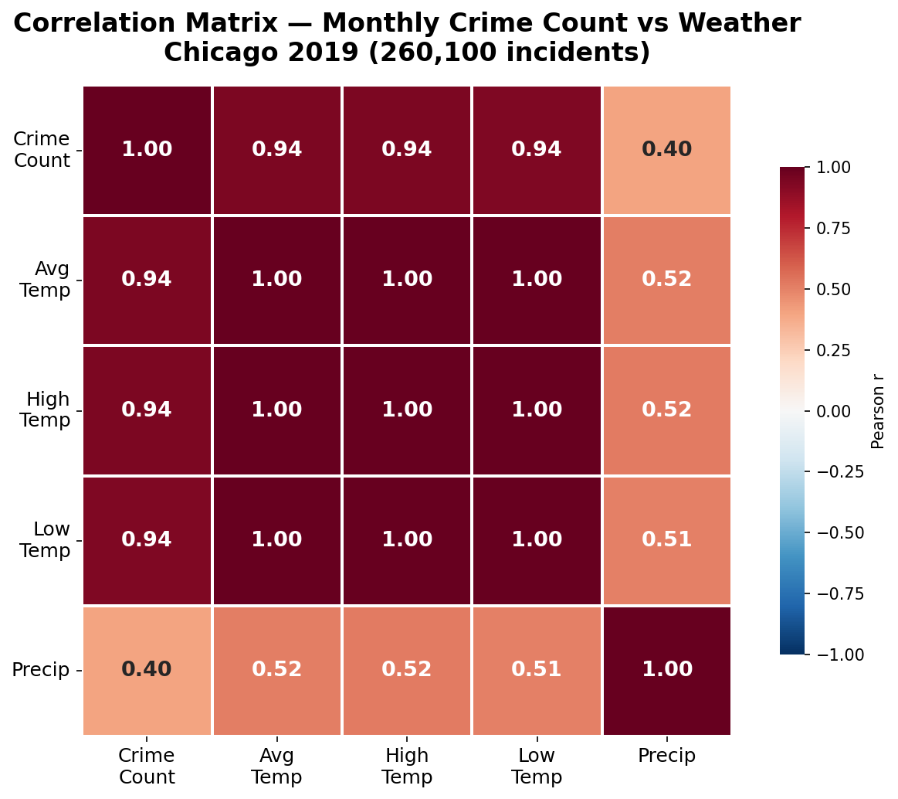
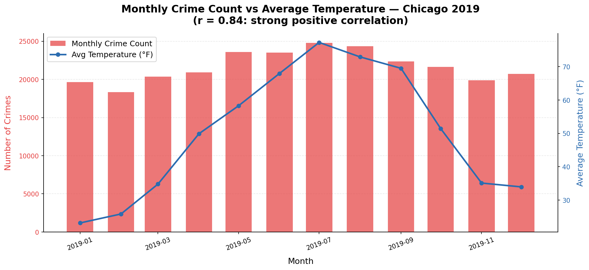
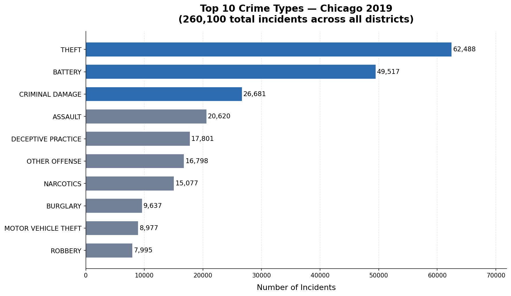

# Chicago Crime & Weather Correlation Analysis

SQL-based analysis of how weather conditions (temperature, precipitation, season) correlate with crime patterns across Chicago in 2019. Uses an in-memory SQLite database to run structured queries on merged crime and weather datasets, with visualizations to surface actionable patterns.

## Tech Stack

- **Language:** Python 3
- **Data:** pandas, sqlite3 (in-memory SQL engine)
- **Visualization:** seaborn, matplotlib
- **Notebook:** Jupyter

## Key Analyses

| Query | Insight |
|---|---|
| Avg temperature per crime type | Which crimes peak in heat vs. cold |
| Crime counts by temp segment (Cold / Moderate / Hot) | Temperature-based crime density |
| Weather-crime correlation | Scatterplot of AvgTemp vs. CrimeCount |
| Season-wise crime trends | Seasonal decomposition by crime category |

## Project Structure

```
.
├── 320final.ipynb            # Main analysis notebook
├── chicago_temps_18-23.csv   # Daily weather data (2018–2023)
├── generate_charts.py        # Rebuilds images/ from the merged CSV
├── images/
│   ├── correlation_heatmap.png    # Pearson r matrix — crime vs weather
│   ├── crime_vs_temperature.png   # Monthly count + temp dual-axis
│   └── top_crime_types.png        # Top 10 crime categories
├── requirements.txt
└── README.md
```

> **Note:** The Chicago crime dataset (~59 MB) and the merged CSVs are not in this repo due to size (see `.gitignore`).
> Download 2019 crimes from the [Chicago Data Portal](https://data.cityofchicago.org/Public-Safety/Crimes-2001-to-Present/ijzp-q8t2) and save it in the project root as `Crimes_-_2019_20231112.csv`. The notebook builds the merged file; `generate_charts.py` reads `merged_crime_weather_2019_fixed.csv`.

## How to Run

```bash
pip install -r requirements.txt
jupyter notebook 320final.ipynb
```

Make sure both input CSV files are in the same directory as the notebook before running.

## Sample Visualizations

- **Temperature vs. Crime Count** – scatterplot showing positive correlation in warmer months
- **Season-Wise Crime Trends** – bar chart comparing crime volumes across Winter / Spring / Summer / Fall

## Key Findings & Insights

**The r=0.94 monthly correlation between temperature and crime count is not just a statistical curiosity — it demonstrates that an exogenous environmental variable can serve as a strong operational demand signal.** This reframes the analysis: rather than asking "does weather cause crime?", the actionable insight is that temperature serves as a leading indicator for resource demand, enabling police departments to adjust staffing and patrol allocation *before* crime peaks rather than in reaction to it. The same logic applies directly to warehouse staffing and last-mile delivery capacity planning, where weather and seasonality are strong leading indicators for order volume.

**Theft (62,488) and Battery (49,517) together make up 43% of the 260,100 incidents in 2019.** This concentration matters operationally: in a resource allocation framework, over-indexing on low-frequency, high-severity events (homicide, arson) at the expense of high-frequency, lower-severity events (theft) would misallocate patrol resources. The equivalent SCM problem is warehouse security and shrinkage: theft concentration analysis at the SKU and aisle level follows the same Pareto structure, and the optimization logic is identical — deploy resources proportional to frequency-weighted impact, not just severity.

**The summer crime peak (June–August) is both predictable and actionable.** Because the seasonal pattern is stable year-over-year, it could support pre-positioning resources ahead of the peak — exactly the same logic used in retail and logistics for peak season preparation (e.g., hiring seasonal staff, pre-positioning inventory at forward distribution centers). The pattern itself is not surprising; the value is in quantifying the magnitude of the seasonal effect to justify budget allocation decisions.

**Three important limitations must be acknowledged.** First, the r=0.94 is computed on only 12 monthly points, and both series follow the same seasonal cycle, so it overstates how well temperature would predict crime on a given day. Second, this analysis covers 2019 only — a single-year snapshot that may not capture multi-year structural trends or event-driven anomalies (e.g., pandemic effects). Third, correlation is not causation: temperature and crime likely share common underlying drivers (outdoor activity levels, school calendars, economic cycles) rather than having a direct causal link. Next steps would include multi-year analysis to validate the pattern's stability and a Vector Autoregression (VAR) model to better decompose the temporal relationship between temperature and crime.

## Relevance to Data Science / SCM Roles

This project demonstrates the same analytical workflow used in supply chain demand planning:

- Joining heterogeneous datasets via SQL (crime + weather → supply events + external factors)
- Segmenting data by external conditions (temperature segments ↔ demand buckets)
- Identifying seasonal patterns for forecasting and planning

## Visualizations

### Correlation Matrix

*Monthly crime count correlates strongly with temperature (r=0.94, 12 months) — warmer months drive significantly higher crime volumes*

### Monthly Crime Count vs Average Temperature

*Summer peak in both crime (red bars) and temperature (blue line) confirms seasonal co-movement across all of 2019*

### Top 10 Crime Types

*Theft (62,488) and Battery (49,517) are the two largest categories*

---

*Data source: [City of Chicago Open Data Portal](https://data.cityofchicago.org/)*
